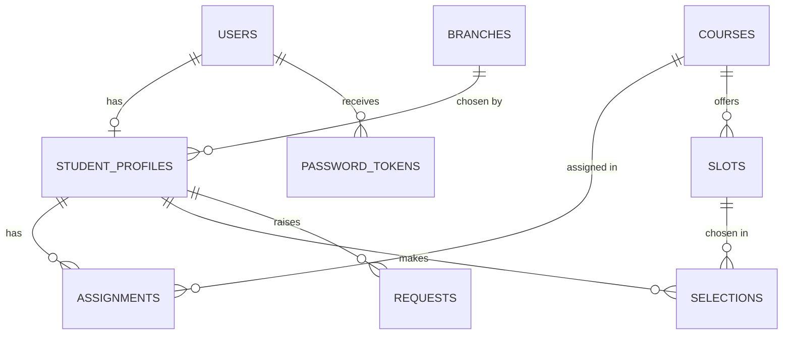

# ExamSlot - Frontend (Loopverse 3.0)

Self-service exam date sheet portal for a multi-branch virtual university.
**Frontend only: plain HTML + CSS + a little JavaScript. No React, no build step, no installs.**
The backend is not built yet. All data is mock data in the browser (`localStorage`, key `es_db2`), shaped like the final API so it can be swapped later.

## Setup (no installation)
1. Unzip and open the `examslot` folder, then open `index.html` (it redirects to the login page).
2. To test on a phone or tablet: run `python3 -m http.server 8000` in this folder and open `http://<your-computer-ip>:8000` on the device (same Wi-Fi). The layout works down to 360 px.
3. To reset the demo data: clear this site's data in the browser (or run `localStorage.clear()` in the console).

**Environment variables:** none for the frontend. The backend (later) needs, for example: `DATABASE_URL`, `JWT_SECRET`, `SMTP_HOST`, `SMTP_USER`, `SMTP_PASS`, `APP_URL`, `INVITE_TOKEN_HOURS=24`, `RESET_TOKEN_HOURS=1`. No secrets are hard-coded in this project; the demo passwords below exist only in mock data.

## Demo credentials (seed data)
| Role | Email | Password | What you see |
|---|---|---|---|
| Admin | admin@examslot.edu.pk | Admin123 | Admin dashboard |
| Student | ali@student.edu.pk | Student123 | Branch chosen, 4 courses, picks slots (try the conflict check) |
| Student | sara@student.edu.pk | Student123 | Saved, locked date sheet (use Need Help) |
| Student | bilal@student.edu.pk | Student123 | 6 courses, picks slots |
| Student | hina@student.edu.pk | Student123 | Only 2 courses: "Assignment incomplete" |
| Student | usman@student.edu.pk | (none yet) | Invite not used: open Forgot password and use the demo link |

**Seed data:** 1 admin, 4 branches (3 active, 1 inactive), 8 courses (1 inactive), 5 students, 13 slots, 2 requests. ENG101 slot "19 Nov 9:00" has 1 seat, so it is full for Karachi (bonus seat capacity demo).
There is no email server yet, so "emailed" setup and reset links appear on screen as demo links.

## Folder structure
```
examslot/
  index.html        redirects to login
  css/style.css     one stylesheet (navy + crimson theme, light and dark, responsive, print rules, mobile bottom-sheet dialogs)
  js/theme.js       light / dark theme switch (saved in the browser, follows the device setting on first visit)
  js/data.js        mock database + seed. Replace with API calls later
  js/app.js         shared helpers: layout, list(), query(), form(), dialogs
  pages/auth/       login, forgot-password, reset-password, error (401/403/404)
  pages/admin/      dashboard, branches, branch-form, courses, course-form, students, student-form,
                    student-detail, assignments, assignment-manage, schedule, slot-form, requests
  pages/student/    select-branch, dashboard, date-sheet, print, help, requests
```

## Pagination note (important)
Every list sends `search`, filters, `page` and `pageSize` to one function, `query()` in `js/app.js`, which returns only that page plus the filtered total (`data, total, totalPages, page`), exactly like the future API. Because there is no server yet, `query()` reads the mock data. When the backend exists, replace the body of `query()` with a `fetch('/api/admin/...')` call and nothing else needs to change.

## Rules implemented in the UI (must also be enforced by the backend)
- 4 to 6 courses per student, no duplicates, only active courses; locked after the date sheet is saved.
- Branch chosen once; the page never reappears unless an approved request sets `branchUnlock`.
- Date sheet saved once; one slot per course from slots the admin created; no two courses on the same date with overlapping time (slot with no end time = 3 hours).
- One pending request per type; approve/reject once; the unlock is single use and consumed when the student saves.
- Seat capacity per branch (bonus): full slots disappear from the student's list; a saved-sheet branch change is refused if a slot is full there.
- Validation: unique email, reg no, branch code, course code; CNIC format; phone format; no past dates (Asia/Karachi); end after start; `<` and `>` rejected in all inputs (XSS) and all output is HTML-escaped.

## Assumptions (where the papers are silent)
- **Safe delete:** a branch, course, slot or saved student that is in use cannot be hard-deleted. The dialog offers "Mark inactive", which hides it from new use but keeps existing selections and sheets. Chosen because it protects students' data without notifying anyone.
- **After a sheet is saved:** admin cannot change that student's assignments (423 Locked) unless an approved date sheet request opened the unlock; removing a course then also removes that course's chosen slot.
- Slot with no end time counts as 3 hours. Invite link 24 h, forgot-password link 1 h, both single use and stored hashed (backend).
- Login lock: 5 failed attempts per email in 15 minutes; forgot password: 3 requests per hour per email (per browser in this demo, per email + IP on the server).
- Profile photo (JPG/PNG, max 2 MB) is checked in the form but not stored until the backend exists. "Download PDF" opens the print view; choose "Save as PDF".
- **Dark mode** is built (sun/moon button on every page; choice is remembered). It replaces the audit log as the bonus item, so there is no audit log. The decision email is not built. Dashboard charts are built.
- The date sheet itself always stays white with black text (it is a printable document), even in dark mode.

## Suggested ERD for the backend

Key columns: `STUDENT_PROFILES(branch_id, branch_unlock, sheet_saved, sheet_unlock, saved_at)`; unique `(student_id, course_id)` on ASSIGNMENTS and SELECTIONS; unique `(course_id, date, start_time)` on SLOTS; `REQUESTS(type, reason, status, remark, consumed)` with one pending per type per student; `PASSWORD_TOKENS(token_hash, expires_at, used)`.

## API to build later
`POST /api/auth/login | logout`, `GET /api/auth/me`, `POST /api/auth/forgot-password`, `GET/POST /api/auth/reset-password`,
`GET /api/admin/dashboard/summary`, `/api/admin/branches`, `/courses`, `/students` (+ `/:id/assignments`, `/:id/resend-invite`, `/:id/photo`), `/slots`, `/requests` (PATCH decision),
`GET /api/student/me | branches | assignments | slots | date-sheet | requests | requests/eligibility`, `POST /api/student/branch | date-sheet | requests`.
The backend must hash passwords, issue the JWT cookie, check the role on every route, and enforce every rule above; the frontend checks are only for user experience.
